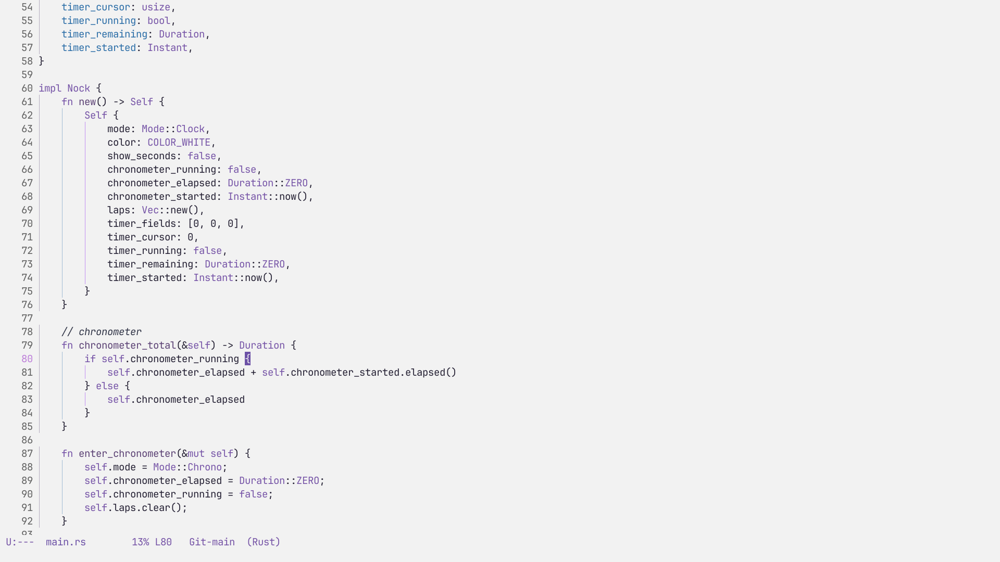

# automata-theme

An Emacs purple-ish light theme inspired by Emilia from the anime Re:Zero

## Screenshot



## Installation

Not yet available on MELPA. Manual installation only.

### Manual

Clone the repository:

```
git clone https://github.com/2besita/emiria-emacs-theme.git
```

Add the path to your Emacs config:

```elisp
(add-to-list 'custom-theme-load-path
             "/path/to/emiria-theme/")
```

Then use `M-x customize-themes` to activate it.

Or add this to your configuration:

```elisp
(load-theme 'emiria t)
```